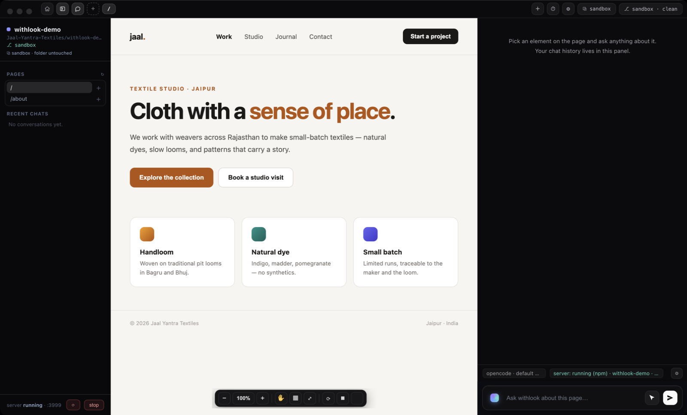

# withlook

**A local-first editor for visual developers.** Load your local web app, pick any element on the live page, and chat with an AI that sees the code behind it — then review the change and apply it safely.

**[Live site](https://withlook.kindhealth.tech/)** · **[GitHub](https://github.com/Jaal-Yantra-Textiles/onlook)** · 

[](https://www.producthunt.com/posts/withlook)



## Why

Most AI coding tools are blind to what you're looking at. withlook runs your real app, lets you point at a specific element, and gives the model its selector, HTML, computed styles, and source excerpt. The result is a concrete answer instead of a guess.

Your project folder is never touched by the agent. Edits and the dev server run in an isolated git worktree (or a temp copy for non-git projects), and you apply the diff when you're ready.

## Features

- **Live preview** of your local web app — Next.js, Vite, and Astro today (Nuxt/SvelteKit/Remix/Angular get the right ports too), with package-manager detection, framework-aware port discovery, route lists, health checks, restart/stop, and attach-to-running-server.
- **Reference images** — drop, paste (⌘⇧V), pick from the dock's image button, or drop on the chat. Each reference is a draggable, resizable card on the canvas; click its dot to include/exclude it from the next message. Vision models get the images directly (e.g. `gpt-4o`, `@cf/meta/llama-3.2-11b-vision-instruct`, or a local vision model); opencode gets file paths.
- **Figma via MCP** — connect to Figma's Dev Mode MCP server in **Connectors**, import a frame, and get its exported code, variables, and screenshot. The screenshot lands as a canvas reference; the code and variables become design context for the next message.
- **Connectors** — a dedicated MCP modal (top-bar plug icon) to add, edit, connect, and delete servers over HTTP or stdio. Figma is the first preset.
- **New project** — pick a starting point: Next.js, Vite (React/Vue/Svelte), Astro, a plain-HTML site, any GitHub boilerplate (shallow clone, optional branch), or your own scaffold command. Plain HTML is served by a built-in static server — no npm, no install.
- **Element picker** (`⌘E`) — validated selectors, highlight box, source search, and open-in-editor at the line.
- **AI chat** — Cloudflare Workers AI, any OpenAI-compatible endpoint, or the local `opencode` agent. Streaming answers, collapsible tool groups, live edit cards with per-file diffs, and one-click file apply in write mode.
- **Safe sandbox** — agent edits + the dev server run in an isolated git worktree. Uncommitted work is mirrored, `node_modules` is symlinked, `.env*` is copied without being committed, and the sandbox is snapshotted so the diff is agent-only. Apply to your folder or discard from the top bar.
- **Home dashboard** — recent projects with thumbnails, GitHub repo, running state, and a first-run onboarding card. Launch always lands here; projects start only when you click one. Hover a card or workspace → `×` twice to remove it and its chats from withlook (the folder stays on disk).
- **Tabs + canvas** — per-route tabs, multi-page canvas, zoom/pan/center over a dotted stage with rounded frames, a floating dock (zoom, pan, multi, center, chat layout, restart/stop, frame count), pan-mode hint, and pop-out preview. Project chrome appears only after the page is fully loaded.
- **Chrome toggles** — hide the sidebar (`⌘B`) and the chat (`⌘⇧J`); the preview takes the space.
- **Git** — project-scoped branch/changes chip, per-file diffs, commit all, and push. Sandbox changes are applied first, then committed/pushed from the same chip.
- **Memory** — Postgres (`withlook` schema) for projects, sessions, and messages, with a local JSON fallback.
- **Global settings** — a centered modal with themed model/agent comboboxes, no page-specific chrome, and a footer with the running version + a GitHub releases link.

## Download

Unsigned builds for now:

- **macOS (Apple Silicon):** [withlook-0.1.0-arm64.dmg](https://github.com/Jaal-Yantra-Textiles/onlook/releases/latest/download/withlook-0.1.0-arm64.dmg) — right-click → Open the first time.
- **Windows (x64):** [withlook-0.1.0-win.zip](https://github.com/Jaal-Yantra-Textiles/onlook/releases/latest/download/withlook-0.1.0-win.zip) — unzip and run `withlook.exe`; choose “More info → Run anyway”.
- [All releases](https://github.com/Jaal-Yantra-Textiles/onlook/releases)

## Run

```bash
npm install
npm start
```

Requires macOS (arm64 builds), Node 20+, and a local web project (Next.js, Vite, or Astro).

## Build

```bash
npm run build      # → dist/withlook-0.1.0-arm64.dmg + .zip (unsigned)
npm run build:dir  # → dist/mac-arm64/withlook.app
npm run icon       # regenerate build/icon.png from build/icon.svg
```

Packaging is the `build` field in `package.json` (electron-builder, macOS arm64, unsigned).

## AI providers

Open **Settings** (`⌘,`):

- **Cloudflare Workers AI** — account ID + API token with Workers AI permission; pick a model from the combobox.
- **OpenAI** — API key and any OpenAI-compatible base URL.
- **Local** — Ollama (`:11434`), LM Studio (`:1234`), llama.cpp (`:8080`), or vLLM (`:8000`). The API key is optional, and **refresh models** lists what's installed via `/v1/models`. Nothing leaves your machine.
- **opencode** — the local agent at `~/.opencode/bin/opencode`; models and agents come from your install. This mode edits files directly (inside the sandbox).

Keys and settings live locally in `~/Library/Application Support/withlook/settings.json`. AI calls run in the main process; pages never see your keys.

## Figma via MCP

withlook speaks MCP. The first integration is Figma's Dev Mode MCP server:

1. Figma desktop → menu → Preferences → **Enable Dev Mode MCP Server**.
2. withlook → top bar → **Connectors** (plug icon) → connect `http://127.0.0.1:3845/mcp`.
3. In the chat, click **figma**, paste a frame URL (or just `12-345`), and **import frame**.

The import calls `get_code`, `get_variable_defs`, and `get_screenshot` over MCP. The screenshot is added as a reference card on the canvas; the exported code and variables travel with your next message as design context.

Connectors supports any HTTP or stdio MCP server: add, edit, enable on launch, connect/disconnect, delete. The client (`main/mcp.js`) implements Streamable HTTP (JSON or SSE) and stdio, `initialize` / `tools/list` / `tools/call`.

**Remote Figma MCP** (`https://mcp.figma.com/mcp`) is **coming soon**. Figma closed dynamic client registration (403) and only grants `mcp:connect` to OAuth clients approved in its [MCP catalog](https://www.figma.com/mcp-catalog); a self-created Figma OAuth app cannot get that scope. The Connectors modal shows the remote option as coming soon. Until an approved client is available, use:

1. **+ Figma (local)** — the Dev Mode server, no auth: `http://127.0.0.1:3845/mcp`.
2. **The opencode agent** — opencode is an approved MCP client; configure Figma MCP in opencode and use the opencode agent.
3. **Access token** — paste a Bearer token from an approved client into a connector's **Access token** field.

The generic OAuth implementation (client ID/secret, PKCE, callback, refresh, sign-out) stays in the codebase for other OAuth MCP servers and for when Figma opens the catalog. For those servers, press **connect** (it reads **sign in**): withlook opens the authorization URL in your system browser, captures the localhost callback, stores the tokens, and connects. Embedded WebViews are not used because Figma rejects them.

## Sandbox

Agent edits are isolated by default:

1. A git worktree is created under `~/Library/Application Support/withlook/worktrees/` on a `withlook/sandbox-*` branch.
2. Your current uncommitted changes are mirrored into it and snapshotted as the sandbox base, so the change report contains only the agent's edits.
3. `node_modules` is symlinked; `.env*` is copied locally and excluded from the commit, report, and apply.
4. The dev server and opencode run in the sandbox — your folder is untouched. Next 16 sandboxes use `next dev --webpack` because Turbopack rejects the linked `node_modules`.
5. The top-bar **sandbox** chip → **Apply to project** or **Discard**. Dirty sandboxes survive quit; clean ones are removed.
6. After applying, open the **git chip** → **Commit all**, then **Push**. The git chip always operates on your real project; the sandbox is the review surface.

Non-git projects fall back to a temp copy. Disable the sandbox in Settings if you want the agent to edit in place.

### Attach to a running server

Use **File → Attach to Running Server…** (⌘⇧O), the home screen's *Already running a dev server?* field, or the **⇢** button in the project sidebar. withlook probes the port, reads the server's working directory to choose the project folder, and marks the session external — the agent edits that folder directly and your server hot-reloads. No sandbox and no apply step in this mode. Custom ports are detected from the app's `dev` script (`-p 8000`, `--port`, `PORT=`).

### Sharing diffs

The change report has **copy** and **save** actions. **save** writes a unified `.patch` plus a `.json` manifest (project, branch, base, files, untracked) to `~/Library/Application Support/withlook/patches/`, so another process or agent can pick it up.

## Memory

By default withlook connects to `postgres://postgres@localhost:5432/postgres` (change it in Settings → Memory). If Postgres is unreachable it falls back to a local JSON file. Data lives in a `withlook` schema — projects, sessions, and messages — so tools like Mason or any MCP Postgres agent can query your withlook memory.

## Keys

`⌘O` open project · `⌘E` pick element · `⌘K` focus chat · `⌘J` toggle panel · `⌘B` hide sidebar · `⌘⇧J` hide chat · `⌘⇧H` home · `⌘R` reload page · `⌘⌥I` page devtools · `⌘,` settings

## Design elements

Every renderer view loads `renderer/elements.css` before its own styles. It owns the token set (`--wl-*`: surfaces, lines, text, accents, radii, type, elevation, focus ring) and the shared controls (`.wl-btn`, `.wl-input`, `.wl-chip`, `.wl-badge`, `.wl-label`, `.wl-note`, `.wl-seg`, `.wl-menu`, `.wl-card`, `.wl-spinner`, `.wl-kbd`). View CSS adds layout only.

Open `renderer/elements.html` to review every token and control. `node test/elements.test.js` keeps the views wired to the layer.

## Architecture

```
main/main.js            Electron main: window + WebContentsViews, dev-server manager,
                        route tabs, canvas camera, AI clients, picker, git, IPC, menus
main/sandbox.js         Isolated git worktree/copy for agent edits (apply/discard/cleanup)
main/frameworks.js      Framework detection + ports + route discovery (Next, Astro, Vite, plain HTML…)
main/local-models.js    Model discovery for local OpenAI-compatible servers (/v1/models)
main/scaffold.js        New-project templates, GitHub clones, plain-HTML writer, custom commands
main/static-server.js   Built-in server for plain-HTML projects
main/references.js      Canvas reference images: copy, downscale, persist, include in chat
main/mcp.js             MCP client: JSON-RPC over Streamable HTTP or stdio
main/mcp-oauth.js       MCP OAuth 2.1: discovery, DCR, PKCE, token refresh
main/mcp-servers.js     Connector configs: normalize, migrate, validate
main/figma.js           Figma URL parsing + get_code/get_variables/get_screenshot mapping
main/store.js           Postgres memory + JSON fallback (withlook.projects/.sessions/.messages)
main/source-search.js   Picked element → candidate source files
main/prompt.js          System prompt + guidelines (direct LLM vs opencode)
main/preload-page.js    Preview page bridge
main/preload-overlay.js Bridge for chrome views
main/picker-inject.js   In-page picker
renderer/overlay.*      Chat pill/dock panel, global settings modal, history
renderer/elements.css   Design tokens + shared controls (buttons, inputs, chips, menus, spinner)
renderer/elements.html  Visual catalog of the tokens and controls
renderer/placeholder.html  Home dashboard + onboarding
renderer/create-project.html  New-project picker: templates, GitHub clone, plain HTML, custom command
renderer/sidebar.html   Project rail (repo, branch, pages, chats, server)
renderer/tabbar.html    Persistent top bar (home, sidebar/chat toggles, tabs, sandbox, git)
renderer/canvas-bar.html  Floating canvas dock (zoom, pan, multi, center, server, frames)
renderer/ref-card.html  Canvas reference card (drag, resize, include/exclude)
website/                Marketing site (published from docs/ at withlook.kindhealth.tech)
```

## Screenshots

| Home | Settings |
| --- | --- |
|  |  |

## Tests

```bash
npx electron . --smoke
npx electron . --test-project /tmp/wl-fake-proj
npx electron test/e2e-welcome.js
npx electron test/e2e-create.js
npx electron test/e2e-picker.js
npx electron test/e2e-combo.js
npx electron test/e2e-settings.js
npx electron test/e2e-tabbar.js
npx electron test/e2e-canvas.js
npx electron test/e2e-refs.js
npx electron test/e2e-figma.js
npx electron test/e2e-connectors.js
npx electron test/e2e-projects.js
node test/store.test.js
node test/source.test.js
node test/prompt.test.js
node test/frameworks.test.js
node test/local-models.test.js
node test/scaffold.test.js
node test/static-server.test.js
node test/elements.test.js
node test/sandbox.test.js
node test/mcp.test.js
node test/mcp-servers.test.js
node test/figma.test.js
npx electron test/references.test.js
npx electron . --test-static
npx electron . --test-load ~/Developer/jyt-web/jyt-web
```

## License

MIT
