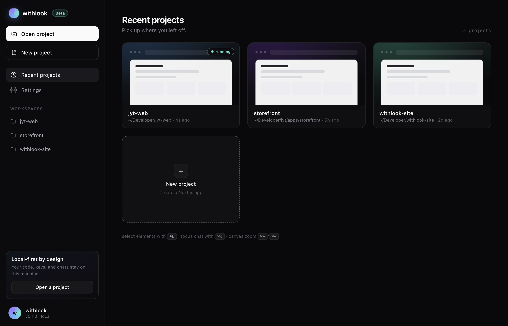
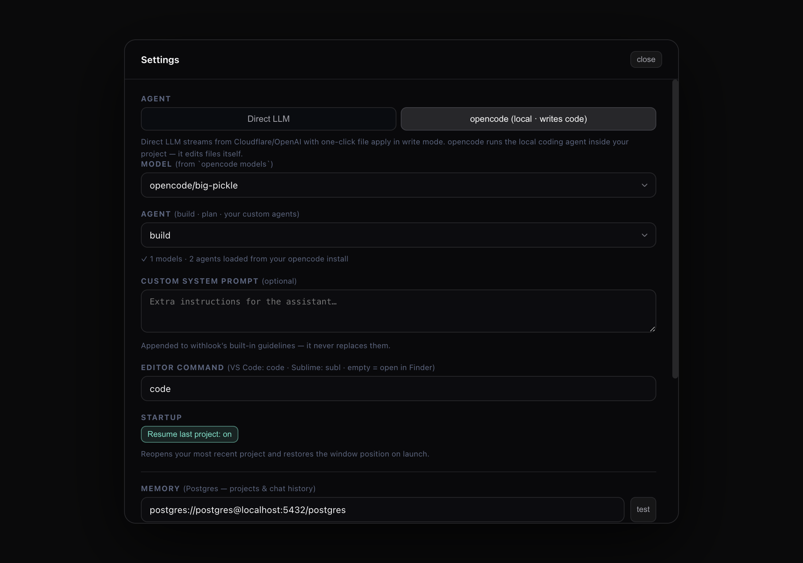

# withlook

**A local-first editor for visual developers.** Load your local Next.js app, pick any element on the live page, and chat with an AI that sees the code behind it — then review the change and apply it safely.

**[Live site](https://jaal-yantra-textiles.github.io/onlook/)** · **[GitHub](https://github.com/Jaal-Yantra-Textiles/onlook)**


## Why

Most AI coding tools are blind to what you're looking at. withlook runs your real app, lets you point at a specific element, and gives the model its selector, HTML, computed styles, and source excerpt. The result is a concrete answer instead of a guess.

Your project folder is never touched by the agent. Edits and the dev server run in an isolated git worktree (or a temp copy for non-git projects), and you apply the diff when you're ready.

## Features

- **Live preview** of your local Next.js app — package-manager detection, port discovery, health checks, restart/stop, and attach-to-running-server.
- **Element picker** (`⌘E`) — validated selectors, highlight box, source search, and open-in-editor at the line.
- **AI chat** — Cloudflare Workers AI, any OpenAI-compatible endpoint, or the local `opencode` agent. Streaming answers, collapsible tool groups, live edit cards with per-file diffs, and one-click file apply in write mode.
- **Safe sandbox** — agent edits + the dev server run in an isolated git worktree. Uncommitted work is mirrored, `node_modules` is symlinked, `.env*` is copied without being committed, and the sandbox is snapshotted so the diff is agent-only. Apply to your folder or discard from the top bar.
- **Home dashboard** — recent projects with thumbnails, GitHub repo, running state, and a first-run onboarding card. Launch always lands here; projects start only when you click one.
- **Tabs + canvas** — per-route tabs, multi-page canvas, zoom/pan, pop-out preview.
- **Chrome toggles** — hide the sidebar (`⌘B`) and the chat (`⌘⇧J`); the preview takes the space.
- **Git** — branch/changes chip, per-file diffs, commit all.
- **Memory** — Postgres (`withlook` schema) for projects, sessions, and messages, with a local JSON fallback.
- **Global settings** — a centered modal with themed model/agent comboboxes, no page-specific chrome.

## Run

```bash
npm install
npm start
```

Requires macOS (arm64 builds), Node 20+, and a local Next.js project.

## Build

```bash
npm run build      # → dist/withlook-0.1.0-arm64.dmg + .zip (unsigned)
npm run build:dir  # → dist/mac-arm64/withlook.app
npm run icon       # regenerate build/icon.png from build/icon.svg
```

Packaging is the `build` field in `package.json` (electron-builder, macOS arm64, unsigned).

## AI providers

Open **Settings** (`⌘,`):

- **Cloudflare Workers AI** — account ID + API token with Workers AI permission; pick a model from the combobox.
- **OpenAI** — API key and any OpenAI-compatible base URL.
- **opencode** — the local agent at `~/.opencode/bin/opencode`; models and agents come from your install. This mode edits files directly (inside the sandbox).

Keys and settings live locally in `~/Library/Application Support/withlook/settings.json`. AI calls run in the main process; pages never see your keys.

## Sandbox

Agent edits are isolated by default:

1. A git worktree is created under `~/Library/Application Support/withlook/worktrees/` on a `withlook/sandbox-*` branch.
2. Your current uncommitted changes are mirrored into it and snapshotted as the sandbox base, so the change report contains only the agent's edits.
3. `node_modules` is symlinked; `.env*` is copied locally and excluded from the commit, report, and apply.
4. The dev server and opencode run in the sandbox — your folder is untouched.
5. The top-bar **sandbox** chip → **Apply to project** or **Discard**. Dirty sandboxes survive quit; clean ones are removed.

Non-git projects fall back to a temp copy. Disable the sandbox in Settings if you want the agent to edit in place.

## Memory

By default withlook connects to `postgres://postgres@localhost:5432/postgres` (change it in Settings → Memory). If Postgres is unreachable it falls back to a local JSON file. Data lives in a `withlook` schema — projects, sessions, and messages — so tools like Mason or any MCP Postgres agent can query your withlook memory.

## Keys

`⌘O` open project · `⌘E` pick element · `⌘K` focus chat · `⌘J` toggle panel · `⌘B` hide sidebar · `⌘⇧J` hide chat · `⌘⇧H` home · `⌘R` reload page · `⌘⌥I` page devtools · `⌘,` settings

## Architecture

```
main/main.js            Electron main: window + WebContentsViews, dev-server manager,
                        route tabs, canvas camera, AI clients, picker, git, IPC, menus
main/sandbox.js         Isolated git worktree/copy for agent edits (apply/discard/cleanup)
main/store.js           Postgres memory + JSON fallback (withlook.projects/.sessions/.messages)
main/source-search.js   Picked element → candidate source files
main/prompt.js          System prompt + guidelines (direct LLM vs opencode)
main/preload-page.js    Preview page bridge
main/preload-overlay.js Bridge for chrome views
main/picker-inject.js   In-page picker
renderer/overlay.*      Chat pill/dock panel, global settings modal, history
renderer/placeholder.html  Home dashboard + onboarding
renderer/create-project.html  create-next-app flow
renderer/sidebar.html   Project rail (repo, branch, pages, chats, server)
renderer/tabbar.html    Persistent top bar (home, sidebar/chat toggles, tabs, sandbox, git)
renderer/canvas-bar.html  Zoom/pan/multi-page dock
website/                Marketing site (published from docs/ at jaal-yantra-textiles.github.io/onlook)
```

## Screenshots

| Home | Settings |
| --- | --- |
|  |  |

## Tests

```bash
npx electron . --smoke
npx electron . --test-project /tmp/wl-fake-proj
npx electron test/e2e-welcome.js
npx electron test/e2e-picker.js
npx electron test/e2e-combo.js
npx electron test/e2e-settings.js
npx electron test/e2e-tabbar.js
node test/store.test.js
node test/source.test.js
node test/prompt.test.js
node test/sandbox.test.js
```

## License

MIT
